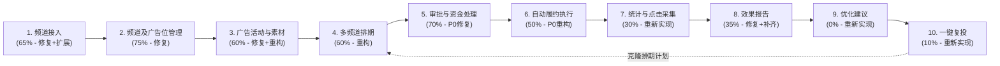

# AUDIT_04：MVP 十步闭环功能差距与依赖清单

- **审计日期**：2026-11-05
- **审计基准**：以最终 MVP 十步全链路闭环为标尺，逐环核验 `ChaBo`（`c8988a4`）与 `TelegramABC`（`dafe912a`）真实代码完成度。

---

## 一、MVP 十步闭环全景依赖拓扑与总览矩阵 `[已验证]`

### 十步环节状态速览表

| 环节序号与名称 | 当前是否存在 | 实现完成度 | 代码质量评级 | 推荐处理方式 | 证据等级 |
| :--- | :--- | :--- | :--- | :--- | :--- |
| **1. 频道接入** | 存在（仅 Bot/CLI，缺 Web 与 ABC 同步） | **65%** | B（重绑存在覆写归属漏洞） | **修复 + 扩展** | `[已验证]` |
| **2. 频道及广告位管理** | 存在（三端 + 评估引擎） | **75%** | B（档位改价与 `rate_cards` 脱节） | **修复** | `[已验证]` |
| **3. 广告活动与素材** | 存在（`ad_materials` + `campaigns`） | **60%** | C+（每单建新 Campaign，Web 缺富媒体上传） | **修复 + 局部重构** | `[已验证]` |
| **4. 多频道排期** | 存在（`placement_plans` 矩阵） | **60%** | C（非原子拆单、忽略 `pin_enabled` 与频次间隔） | **重构** | `[已验证]` |
| **5. 审批与资金处理** | 存在（账本 + 双人充值 + 审单） | **70%** | C（含 4 项 P0 级并发/负数/无款重审/零服务费漏洞） | **修复（P0 最高优）** | `[已验证]` |
| **6. 自动履约** | 存在（`fulfillment.py`） | **50%** | D（长事务包 HTTP + 私信回滚致无限重发，无自动下架） | **重构（P0 最高优）** | `[已验证]` |
| **7. 统计采集** | 仅存在深链（缺短链与浏览量采样） | **30%** | B-（深链可用，外链点击与 MTProto 采样缺失） | **保留深链 + 重新实现短链/采样** | `[已验证]` |
| **8. 效果报告** | 仅存在后端基础方法（含 JOIN 膨胀 Bug） | **35%** | D+（SQL JOIN 放大花费 N 倍，Web 报告页缺失） | **修复后端 + 重新实现 Web/分享页** | `[已验证]` |
| **9. 优化建议** | 不存在 | **0%** | N/A | **重新实现（轻量规则引擎）** | `[已验证]` |
| **10. 复投** | 仅存在手动重填（无一键复投） | **10%** | N/A | **重新实现（基于排期克隆）** | `[已验证]` |

---

## 二、十个核心环节逐项深度差距分析 `[已验证]`

### 环节 1：频道接入（Channel Onboarding & Sync）
- **当前是否存在**：存在（Bot 端自动/手动绑频道 + CLI 绑频道；Web 端与 `TelegramABC` 同步接口尚未接入）。
- **实现完成度及证据**：**65%**
  - 已实现 `ChannelService.bind_channel()`（[channel.py](file:///c:/Users/Andy/Antigravity/ChaBo/src/chabo/services/channel.py#L41-L148)），支持自动初始化 `channel_configs`、`rate_cards` 及 `pin24h`/`push`/`button_tail` 广告位策略。
  - 已实现 Bot 被拉入频道为管理员时的 `my_chat_member` 自动绑定与管理员验权（[bot.py](file:///c:/Users/Andy/Antigravity/ChaBo/src/chabo/bot.py#L541-L632)）。
  - `TelegramABC` 已具备 `GET /api/plugins/assets/channels`（[plugins.py](file:///c:/Users/Andy/Antigravity/TelegramABC/apps/api/routers/plugins.py#L285-L315)），但 `ChaBo` 尚无客户端调用它。
- **代码质量**：**B**（Bot 验权逻辑较完整，但缺少归属权变更保护）。
- **依赖关系**：依赖 `TelegramABC` Plugin Gateway（自有频道批量导入）与 `BotApiClient.get_chat_member`（Bot 权限自检）。
- **主要风险**：
  - **[DEF-06 / P0]** 当频道内另一名管理员触发 `bind_channel` 或 `my_chat_member` 时，`UPDATE channels SET owner_account_id = ?`（[channel.py](file:///c:/Users/Andy/Antigravity/ChaBo/src/chabo/services/channel.py#L82-L90)）直接覆盖原频道主 ID，导致历史未结算订单在 24h 确认收益时因新账号无 `pending_earnings_cents` 而抛异常崩溃（`test_07b` 已证实）。
- **需要补充的功能**：
  1. 锁定已有活跃频道的 `owner_account_id`（非管理员显式走“频道所有权转移并结清待确认收益”流程，禁止覆盖 `owner_account_id`）。
  2. 新增 `TelegramABCClient.sync_owned_channels()` 及后台 `/admin#channels`“从 TelegramABC 同步自有频道”按钮。
  3. 新增频道主 Web 端 `/publisher#channels` 绑定引导与实时 Bot 权限检测按钮。
- **推荐处理方式**：**修复（归属权保护） + 扩展（接入 `TelegramABC` 只读同步）**。

---

### 环节 2：频道及广告位管理（Channel & Slot Management）
- **当前是否存在**：存在。
- **实现完成度及证据**：**75%**
  - 已实现三维质量评估与 S/A/B/C/D 评级定价（`PricingService.assess_channel`，[channel.py](file:///c:/Users/Andy/Antigravity/ChaBo/src/chabo/services/channel.py#L1102-L1204)）。
  - 已实现广告格式开关与三档价格策略表 `channel_format_policies`（`pin24h`/`push`/`button_tail`，`light_tail` 已在迁移 `0013` 下线，[db.py](file:///c:/Users/Andy/Antigravity/ChaBo/src/chabo/db.py#L1030-L1038)）。
  - 已实现频道锁档日历表 `channel_schedule_blocks` 与 Web 端日历面板（[CalendarPanel.tsx](file:///c:/Users/Andy/Antigravity/ChaBo/web/src/pages/publisher/panels/CalendarPanel.tsx#L1-L165)）。
- **代码质量**：**B**（评估模型扎实，但 Web 改价接口与底层计费表存在双轨分裂）。
- **依赖关系**：依赖环节 1 的频道基础数据与环节 7 的频道真实指标（订阅数、24h 中位浏览量）。
- **主要风险**：
  - **[DEF-14 / P1]** Web API `PATCH /api/publisher/channels/{id}/rate`（[main.py](file:///c:/Users/Andy/Antigravity/ChaBo/src/chabo/webapi/main.py#L1121-L1135)）允许频道主绕过三档限制输入任意美分单价；而通过 `set_format_policy`（[channel.py](file:///c:/Users/Andy/Antigravity/ChaBo/src/chabo/services/channel.py#L292-L348)）切换 `low`/`medium`/`high` 档位却不更新 `rate_cards.unit_price_cents`，导致下单计费金额与所选档位不一致。
  - `channel_configs` 中的 `daily_ad_limit`、`allowed_start_hour`、`allowed_end_hour`、`category_blocklist_json` 仅可读写配置，未在排期和发帖时强制执行拦截。
- **需要补充的功能**：
  1. 废弃任意金额改价接口，统一改为切换 `low`/`medium`/`high` 档位并实时联动计算下单单价。
  2. 在 `OrderService._create_order_impl` 与 `PlacementPlanService` 中强制校验频道黑名单类目、可投放时间窗、每日最大广告上限及 `channel_schedule_blocks` 锁档冲突。
- **推荐处理方式**：**修复**。

---

### 环节 3：广告活动与素材（Campaigns & Ad Materials）
- **当前是否存在**：存在。
- **实现完成度及证据**：**60%**
  - 已实现 `MaterialService`（创建、列表、更新、停用素材，支持 `text`/`photo`/`video` 与审批复核指纹，[order.py](file:///c:/Users/Andy/Antigravity/ChaBo/src/chabo/services/order.py#L130-L390)）。
  - Web 端已实现素材列表与纯文本新建面板（[MaterialsPanel.tsx](file:///c:/Users/Andy/Antigravity/ChaBo/web/src/pages/advertiser/panels/MaterialsPanel.tsx#L1-L130)）。
- **代码质量**：**C+**。
- **依赖关系**：为环节 4（多频道排期）提供投放内容载体。
- **主要风险**：
  - `OrderService._create_order_impl`（[order.py](file:///c:/Users/Andy/Antigravity/ChaBo/src/chabo/services/order.py#L892-L914)）每创建一笔订单都自动 `INSERT INTO campaigns` 和 `INSERT INTO creatives`，导致一个排期计划拆出 10 笔订单就会产生 10 个孤立的 `campaigns`，无法按“一次投放活动（Campaign）”聚合统计 ROI。
  - Web API 未暴露 `MaterialService.update_material`，且不支持在 Web 端上传图片/视频获取 `media_file_id`（目前仅能通过 Bot 私聊发送图片/视频创建富媒体素材）。
- **需要补充的功能**：
  1. 将 `placement_plans` 与单个 `campaign_id` 1:1 关联，同一排期计划拆出的所有 `ad_orders` 共享同一个 `campaign_id`。
  2. 在 `webapi/main.py` 暴露素材编辑 `PATCH /api/advertiser/materials/{id}` 与媒体上传转存接口（通过 Bot API 发送至内部素材缓存频道换取 `file_id`，并可调用 `TGWorker` 的 `content_filter` 做前置违禁词校验）。
- **推荐处理方式**：**修复 + 局部重构**。

---

### 环节 4：多频道排期（Multi-Channel Placement Planning）
- **当前是否存在**：存在。
- **实现完成度及证据**：**60%**
  - 已建立 `placement_plans`、`placement_plan_items`、`placement_plan_orders` 三张表（[db.py](file:///c:/Users/Andy/Antigravity/ChaBo/src/chabo/db.py#L502-L527)、[#L890-L932](file:///c:/Users/Andy/Antigravity/ChaBo/src/chabo/db.py#L890-L932)）。
  - 已实现 `PlacementPlanService`（[plans.py](file:///c:/Users/Andy/Antigravity/ChaBo/src/chabo/webapi/plans.py#L1-L348)）及前端选号车 + 排期工作台（[CatalogPanel.tsx](file:///c:/Users/Andy/Antigravity/ChaBo/web/src/pages/advertiser/panels/CatalogPanel.tsx#L1-L215)、[PlansPanel.tsx](file:///c:/Users/Andy/Antigravity/ChaBo/web/src/pages/advertiser/panels/PlansPanel.tsx#L1-L240)）。
- **代码质量**：**C**。
- **依赖关系**：依赖环节 2（频道档位与库存日历）、环节 3（广告素材）及环节 5（预算校验与预占）。
- **主要风险**：
  - **[DEF-11a / P1]** `submit_plan`（[plans.py](file:///c:/Users/Andy/Antigravity/ChaBo/src/chabo/webapi/plans.py#L172-L267)）跨多个独立事务循环调用 `create_order`：若第 2 个频道下单失败，第 1 个频道已扣款生成孤儿订单，而计划状态仍为 `draft`（`test_05a` 已证实）。
  - **[DEF-11b / P1]** `placement_plan_items.pin_enabled` 在拆单时被完全忽略（`#L222-L234`）。
  - **[DEF-11c / P1]** `maybe_schedule_next`（[order.py](file:///c:/Users/Andy/Antigravity/ChaBo/src/chabo/services/order.py#L1690)）固定 `+ timedelta(days=1)`，忽略 `frequency_per_day > 1`（`test_05b` 已证实）。
  - 前端 `PlansPanel.tsx` 在排期计划创建后不支持单行增删频道或修改单行时间/频次。
- **需要补充的功能**：
  1. 将 `submit_plan` 重构为单个数据库事务原子执行（全部子订单预占成功才提交，任一失败全量回滚）。
  2. 修复 `maybe_schedule_next` 按 `timedelta(hours=24 / frequency_per_day)` 计算下一投递时间点。
  3. 补齐排期草稿单行编辑/删除 API（`PATCH/DELETE /api/advertiser/plans/{id}/items/{item_id}`）与前端交互。
- **推荐处理方式**：**重构**。

---

### 环节 5：审批与资金处理（Approval & Funds Ledger）
- **当前是否存在**：存在。
- **实现完成度及证据**：**70%**
  - 已实现四态/六字段整数美分账本（[wallet.py](file:///c:/Users/Andy/Antigravity/ChaBo/src/chabo/services/wallet.py#L221-L961)）、双人充值审批表 `topup_approval_requests`（`#L964-L1197`）、Stars 支付（[billing.py](file:///c:/Users/Andy/Antigravity/ChaBo/src/chabo/services/billing.py#L409-L517)）及管理员审单/充值审批面板（[OrdersPanel.tsx](file:///c:/Users/Andy/Antigravity/ChaBo/web/src/pages/admin/panels/OrdersPanel.tsx#L1-L150)、[TopupsPanel.tsx](file:///c:/Users/Andy/Antigravity/ChaBo/web/src/pages/admin/panels/TopupsPanel.tsx#L1-L160)）。
- **代码质量**：**C**（表结构设计优秀，但事务边界与状态条件存在致命漏洞）。
- **依赖关系**：承接环节 4 的下单冻结与环节 6 的履约扣款/24h 结算。
- **主要风险**：
  - **[DEF-03 / P0]** `approve_topup` 跨 3 个事务导致并发双倍入账（`test_01` 已证实）。
  - **[DEF-04 / P0]** `manual_topup` 允许负数金额直接扣减余额（`test_02` 已证实）。
  - **[DEF-05 / P0]** `pause_and_release` 退款后，`approve_order` 允许无资金重审 `paused` 订单（`test_07a` 已证实）。
  - **[DEF-07 / P0]** `service_fee_bps` 在未订阅（强制免佣引流）和已订阅（免佣）下恒为 0。
  - **[DEF-13 / P1]** 10% `holdback_bps` 质保金永久不释放；核心资金操作未写入防篡改 `audit_logs`。
- **需要补充的功能**：
  1. 将 `approve_topup` 收敛至单个 `BEGIN IMMEDIATE` 事务，使用 `UPDATE topup_approval_requests SET status='approved' WHERE request_id=? AND status='pending'` 影响行数 `rowcount == 1` 作为 CAS 锁。
  2. 强制校验 `manual_topup` / `request_topup` 的 `amount_cents > 0`；禁止 `approve_order` 审批 `status == 'paused'` 的订单（必须先重新冻结预算）。
  3. 修正 `service_fee_bps` 逻辑（不强行覆写 `platform_promo_enabled=1`，对未订阅且未主动开启引流置换的频道正常收取 5% 平台费）；在 `deliveries` 落库时固化 `publisher_account_id` 快照，解耦后续频道重绑影响。
  4. 新增 `release_due_holdback()` 释放满 7 天的 10% 质保金，并在所有资金变动处强制调用 `insert_audit_log()`。
- **推荐处理方式**：**修复（Phase 0 最高优先级）**。

---

### 环节 6：自动履约（Automated Telegram Fulfillment）
- **当前是否存在**：存在。
- **实现完成度及证据**：**50%**
  - 已实现 `FulfillmentService.dispatch_due()`（[fulfillment.py](file:///c:/Users/Andy/Antigravity/ChaBo/src/chabo/fulfillment.py#L29-L350)），支持 `pin24h`（发帖+置顶）、`push`（普通发帖）、`button_tail`（修改频道最新原生帖挂载三按钮）。
- **代码质量**：**D**（事务边界设计严重错误，是全系统最大故障源）。
- **依赖关系**：依赖环节 5（订单已批准且预算已冻结）及 `BotApiClient`。
- **主要风险**：
  - **[DEF-01 / P0]** 单个 SQLite 写事务包裹最多 20 笔投递的全部外部 Telegram HTTP 请求，且 `_maybe_notify_budget` 私信失败未捕获异常，导致**频道已发帖但事务回滚、后续无限重复发帖且不扣款**（`test_03` 已证实）。
  - **[DEF-02 / P0]** 无 `sending` 预占态与 `reconciliation_required` 对账态，`pin_message` 失败或网络读超时直接标 `failed` 并全额退款（`test_04` 已证实）。
  - 无 `pin24h` 到期取消置顶（`unpinChatMessage`）与到期自动删帖（`deleteMessage`）。
- **需要补充的功能**：
  1. **三段式状态机重构**：
     - **阶段 1（短事务 < 2ms）**：CAS 抢占到期任务，`UPDATE deliveries SET status='sending', attempt_count=attempt_count+1 WHERE id=? AND status='scheduled'`，立即提交释放写锁。
     - **阶段 2（无数据库事务）**：调用 `BotApiClient` 执行发帖/置顶；只要 `send_ad` 返回了 `message_id`，即便后续 `pin_message` 失败也必须保留 `message_id`（标记 `pin_failed` 告警或降级，绝不丢弃 `message_id`）。
     - **阶段 3（短事务 < 2ms）**：若拿到 `message_id`，更新 `status='sent'` 并调用 `charge_delivery` 扣款；若发生网络超时状态未知，标记为 `status='reconciliation_required'` 挂起冻结款等待人工/自动核验，严禁盲目自动全额退款；将所有私信通知放到扣款事务提交**之后**异步/容错执行。
  2. 在 `BotApiClient` 补齐 `unpin_chat_message` 与 `delete_message`，并在 `deliveries` 增加 `unpin_at` / `delete_at` 到期清理调度。
- **推荐处理方式**：**重构（Phase 0 最高优先级）**。

---

### 环节 7：统计采集（Metrics & Click Collection）
- **当前是否存在**：仅存在 Bot 深链采集（30%），HTTP 短链与浏览量采样缺失。
- **实现完成度及证据**：**30%**
  - 已实现 `/start ad_<delivery_id>` 深链统计写入 `metric_snapshots`（[bot.py](file:///c:/Users/Andy/Antigravity/ChaBo/src/chabo/bot.py#L150-L174)）。
  - 缺失 HTTP 短链重定向 `/r/{token}`（[fulfillment.py](file:///c:/Users/Andy/Antigravity/ChaBo/src/chabo/fulfillment.py#L212) 直接裸放 `target_url`）。
  - 缺失投递后 1h / 6h / 24h / 48h 的 `message_views` 自动采样任务。
- **代码质量**：**B-**（深链部分简洁可靠）。
- **依赖关系**：依赖环节 6 产出的 `delivery_id` 与 `(channel_tg_id, message_id)`，以及 `TelegramABC` 的 MTProto 浏览量读取接口。
- **主要风险**：
  - 绝大多数广告主的 CTA 是外部网页、群组或独立 Bot，不经过 `ChaBo` Bot 的 `/start ad_<id>`；若无 `/r/{token}` 短链，90% 以上的外链广告点击数将恒为 0，后续效果报告与优化建议沦为无源之水。
- **需要补充的功能**：
  1. 新增 `tracking_links` 与 `click_events` 表，在 [webapi/main.py](file:///c:/Users/Andy/Antigravity/ChaBo/src/chabo/webapi/main.py) 实现 `GET /r/{token}` 302 跳转（记录时间戳、IP Hash/UA 指纹实现 UV 去重），并在 `fulfillment.py` 发帖时自动将 `target_url` 包装为短链。
  2. 新增 `MetricsCollectorService`，定时通过 `TelegramABC` Plugin Gateway 拉取已发帖 `message_id` 在 1h / 6h / 24h / 48h 的 `views` 与存活状态写入 `metric_snapshots`。
- **推荐处理方式**：**保留深链 + 重新实现（HTTP 短链与浏览量采样）**。

---

### 环节 8：效果报告（Performance Reporting）
- **当前是否存在**：后端与 Bot 存在简版实现（含严重计算 Bug），Web 端完全缺失。
- **实现完成度及证据**：**35%**
  - `AdvertiserService.report()`（[billing.py](file:///c:/Users/Andy/Antigravity/ChaBo/src/chabo/services/billing.py#L907-L976)）计算总花费、曝光、点击、互动及分频道排行。
- **代码质量**：**D+**。
- **依赖关系**：依赖环节 7 采集的 `views`、`clicks`（短链 UV + 深链 `/start`）与环节 5 的实际扣款流水。
- **主要风险**：
  - **[DEF-12 / P1]** `billing.py#L946-L962` 使用 `FROM ad_orders o LEFT JOIN deliveries d` 直接对 `o.spent_cents` 求 `SUM`、对 `o.id` 求 `COUNT`，导致有 N 次投递的订单在分频道报表中**花费和订单数被放大 N 倍**（`test_06` 已证实）。
  - Web 广告主端 `/advertiser` 没有任何效果报告面板，也不支持生成免登录客户分享链接 `/reports/:token`。
- **需要补充的功能**：
  1. 修复 `AdvertiserService.report` 的 SQL 聚合逻辑（改为按 `deliveries` 关联 `ledger_entries` 实际扣费或先对 `ad_orders` 子查询聚合后再关联 `metric_snapshots`），并补充计算核心衍生指标：**CPM**（千次阅读成本）、**CTR**（点击率 = UV 点击 / 24h 阅读）、**CPC**（单次点击成本）。
  2. 在 Web 端 `/advertiser` 新增「效果报告（Reports）」面板，并实现带签名/过期时间的只读分享路由 `GET /api/public/reports/{share_token}` 与前端 `/reports/:token` 页面。
- **推荐处理方式**：**修复后端 SQL + 重新实现 Web 报告与分享页**。

---

### 环节 9：优化建议（Rule-Based Optimization Recommendations）
- **当前是否存在**：不存在。
- **实现完成度及证据**：**0%**（全库检索无 `recommendation` 相关表或服务）。
- **代码质量**：N/A。
- **依赖关系**：强依赖环节 8 的真实 CPM / CTR / CPC 与频道历史基准值（Benchmark）。
- **主要风险**：若过度设计为依赖外部 LLM 的实时生成，会带来高延迟、幻觉与 API 成本风险；MVP 阶段应严格采用**确定性四象限规则引擎**。
- **需要补充的功能**：
  1. 在报告服务中实现确定性规则引擎 `RecommendationEngine`，针对每个已结案频道/素材对比同品类基准（`channel_metrics.median_24h_views` 与平均 CTR），自动产出 4 类结构化动作标签：
     - **`scale_up`（建议复投/加投）**：24h 曝光达标率 `>= 90%` 且 `CPC` 低于均值 20%。
     - **`replace_creative`（建议更换素材）**：24h 曝光达标率 `>= 80%` 但 `CTR < 0.3%`（有曝光无点击，说明频道流量真但文案/按钮吸引力不足）。
     - **`reduce_frequency`（建议降频或改时段）**：同频道第 2/3 次投递的曝光或 CTR 较首次衰减 `> 50%`。
     - **`pause_channel`（建议停投该频道）**：24h 曝光达标率 `< 40%` 或 `CPC` 高于均值 200%。
- **推荐处理方式**：**重新实现（纯确定性规则引擎，不引入 LLM 依赖）**。

---

### 环节 10：复投（One-Click Re-invest / Plan Cloning）
- **当前是否存在**：仅支持手工重新选号建计划，无一键复投。
- **实现完成度及证据**：**10%**（已有 `PlacementPlanService.create_plan`，但无从历史计划或效果报告筛选优质频道一键克隆的接口）。
- **代码质量**：N/A。
- **依赖关系**：依赖环节 9（优化建议筛选出的 `scale_up` 频道列表）与环节 4（`placement_plans` 创建接口）。
- **主要风险**：若复投时不重新拉取最新刊例价或顺延排期时间至未来（`now + Δt`），会导致用过期时间戳下单直接报错。
- **需要补充的功能**：
  1. 在 `PlacementPlanService` 新增 `clone_plan(source_plan_id, filter_channel_ids=None, time_shift_days=...)`（`POST /api/advertiser/plans/{id}/reinvest`）：支持“全量克隆”或“仅克隆效果报告中标记为 `scale_up` 的优质频道”，自动将排期开始时间顺延至下一可用周期并生成新 `draft` 计划。
  2. 在 Web 端「效果报告」与「排期计划」页面提供「一键复投优质频道」按钮，点击后直达预填好的新排期草稿确认页。
- **推荐处理方式**：**重新实现**。

---

### 附：明确建议「暂缓（Defer）」的功能清单 `[已验证]`
以下功能不属于 MVP 闭环关键路径，建议在首轮 10～20 单真实投放跑通前**一律暂缓投入**：
1. **PostgreSQL 数据库迁移与多机分布式部署**（暂缓，SQLite WAL 修好长事务后完全够用）。
2. **LLM 大模型文案改写与 AI 向量检索选号（pgvector）**（暂缓，先用确定性三维评分与四象限规则引擎）。
3. **广告主外部网站 S2S Postback 转化回传 SDK**（暂缓，MVP 先聚焦短链点击 UV 与 Bot `/start` 深链）。
4. **链上 USDT/TON 自动充提网关与自动打款（`payout_batches` 自动打款）**（暂缓，MVP 阶段充值走双人审批入账 + Stars，频道主提现走人工财务核对打款）。
