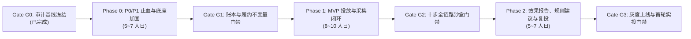

# AUDIT_05：开发阶段划分与门禁验收建议

- **审计日期**：2026-11-05
- **技术路线基准**：路线 B（保留 `ChaBo` 核心模块 + 局部靶向重构 + `TelegramABC` 只读网关集成，保持 SQLite WAL）
- **总体预估工期**：**18 ～ 24 人日**（分 3 个研发阶段 + 1 个真实灰度验证阶段，通过 G0～G3 四道硬性质量门禁控制进度）

---

## 一、研发阶段全景路线图 `[已验证]`

---

## 二、分阶段任务拆解、涉及文件与验收标准

### Phase 0：P0/P1 止血与核心底座加固（预计 5 ～ 7 人日）

> **阶段目标**：不加任何新花哨功能，100% 集中消灭本报告查出的 **7 个 P0 级与 8 个 P1 级缺陷**，让现有 189 个原生单测与 7 个专项攻防测试在 Windows / Linux 下全部零报错通过。

#### 1. 核心改造任务清单
| 任务编号 | 对应缺陷 | 改造内容与技术方案 | 涉及文件与行号 |
| :--- | :--- | :--- | :--- |
| **P0-T1** | **DEF-01** **DEF-02** | **重构 `FulfillmentService` 为三段式 CAS 状态机**： ① 新增迁移 `0014`：允许 `deliveries.status` 取值 `'sending'`、`'reconciliation_required'`，增加 `publisher_account_id`、`unpin_at`、`delete_at` 字段； ② 阶段 1（短事务 `< 2ms`）：CAS 抢占 `scheduled -> sending` 并立即提交释放 SQLite 写锁； ③ 阶段 2（事务外）：调用 `BotApiClient` 发帖；只要拿到 `message_id` 立即持久化，若后续 `pin_message` 失败仅记录告警不回滚已发帖状态； ④ 阶段 3（短事务 `< 2ms`）：扣款并置为 `sent`（若网络读超时未知则置为 `reconciliation_required` 挂起冻结款，严禁自动全额退款）； ⑤ 将所有私信通知（含 `_maybe_notify_budget`）移至扣款事务提交后执行，并全量包裹 `try ... except TelegramError`。 | [fulfillment.py](file:///c:/Users/Andy/Antigravity/ChaBo/src/chabo/fulfillment.py#L29-L350) [db.py](file:///c:/Users/Andy/Antigravity/ChaBo/src/chabo/db.py#L166-L185) |
| **P0-T2** | **DEF-03** **DEF-04** **DEF-05** | **修复资金账本 3 大漏洞**： ① 将 `TopupApprovalService.approve_topup` 合并为单个 `with self.db.transaction()`，使用 `UPDATE ... WHERE request_id=? AND status='pending'` 校验 `rowcount == 1` 防并发双倍入账； ② 在 `LedgerService.manual_topup` 与 `request_topup` 入口强制校验 `amount_cents > 0`； ③ 在 `OrderService.approve_order` 中移除 `"paused"`，严禁在 `reserved_cents < budget_cents` 时直接批准订单。 | [wallet.py](file:///c:/Users/Andy/Antigravity/ChaBo/src/chabo/services/wallet.py#L435-L482), [#L1021-L1063](file:///c:/Users/Andy/Antigravity/ChaBo/src/chabo/services/wallet.py#L1021-L1063) [order.py](file:///c:/Users/Andy/Antigravity/ChaBo/src/chabo/services/order.py#L1122-L1145) |
| **P0-T3** | **DEF-06** **DEF-07** **DEF-13** | **修复结算、服务费与审计哈希链**： ① `bind_channel` / `my_chat_member` 遇到已绑定且有未结清订单的频道时，禁止直接覆盖 `owner_account_id`；同时 `charge_delivery` / `confirm_publisher_earning` 改为按 `deliveries.publisher_account_id` 快照结算； ② 修复 `_effective_service_fee_bps`，未订阅且未开启免佣引流的频道恢复收取 5%（`500 bps`）平台服务费； ③ 实现 `release_due_holdback()` 释放满 7 天的 10% 质保金；在充值、审单、扣款、退款处统一调用 `insert_audit_log()`，并将 `verify_audit_chain` 默认设为 `strict_unsigned=True`。 | [channel.py](file:///c:/Users/Andy/Antigravity/ChaBo/src/chabo/services/channel.py#L82-L90) [order.py](file:///c:/Users/Andy/Antigravity/ChaBo/src/chabo/services/order.py#L878-L888), [#L1855-L1865](file:///c:/Users/Andy/Antigravity/ChaBo/src/chabo/services/order.py#L1855-L1865) [wallet.py](file:///c:/Users/Andy/Antigravity/ChaBo/src/chabo/services/wallet.py#L853-L889) [audit.py](file:///c:/Users/Andy/Antigravity/ChaBo/src/chabo/audit.py#L74) |
| **P0-T4** | **DEF-08** **DEF-09** **DEF-14** | **修复三端 RBAC、代看只读限制与新用户死锁**： ① 在 `deps.py` 中对带 `impersonator_account_id` 的 Session 强制拦截所有非 `GET/HEAD/OPTIONS` 请求（返回 HTTP 403 `"管理员代看模式仅限只读浏览"`）； ② 移除管理员未开启代看时对 `/api/advertiser/*` 与 `/api/publisher/*` 的隐式跨门户特权；将 `admin_level()` 默认回退值改为 `"viewer"`； ③ 允许 `status in {'active', 'candidate'}` 进入广告主/频道主门户，消除新用户 403 死锁； ④ 下线任意金额改价接口 `PATCH /api/publisher/channels/{id}/rate`，并在 `set_format_policy` 切换三档时同步更新对应档位价格。 | [deps.py](file:///c:/Users/Andy/Antigravity/ChaBo/src/chabo/webapi/deps.py#L93-L100) [auth.py](file:///c:/Users/Andy/Antigravity/ChaBo/src/chabo/webapi/auth.py#L94-L138) [main.py](file:///c:/Users/Andy/Antigravity/ChaBo/src/chabo/webapi/main.py#L1121-L1135) [channel.py](file:///c:/Users/Andy/Antigravity/ChaBo/src/chabo/services/channel.py#L292-L348) |
| **P0-T5** | **DEF-10** **DEF-15** **DEF-16** | **修复 DB 连接句柄、合流 `web.py` 路由、修复 `bot.py` 与 `Dockerfile`**： ① 将 `Database.connect()` 包装为退出上下文时自动 `close()`，并将 `PRAGMA busy_timeout` 统一设为 `30000`（30 秒）； ② 将 `POST /telegram/webhook`、`dispatch-due`、`confirm-earnings` 迁入 `webapi/main.py`，废弃 `src/chabo/web.py` 重复查询代码； ③ 在 `bot.py` 顶部补齐 `logger = logging.getLogger(__name__)`； ④ 修改 `Dockerfile#L21` 为 `pip install --user --no-cache-dir ".[web]"`，将 `CHABO_BOT_AUTO_APPROVE_ORDERS` 默认值改为 `False`（`"0"`）。 | [db.py](file:///c:/Users/Andy/Antigravity/ChaBo/src/chabo/db.py#L666-L698) [web.py](file:///c:/Users/Andy/Antigravity/ChaBo/src/chabo/web.py#L227-L277) [bot.py](file:///c:/Users/Andy/Antigravity/ChaBo/src/chabo/bot.py#L1-L25) [Dockerfile](file:///c:/Users/Andy/Antigravity/ChaBo/Dockerfile#L21) [config.py](file:///c:/Users/Andy/Antigravity/ChaBo/src/chabo/config.py#L40) |

#### 2. Gate G1 门禁验收标准（必须 100% 满足方可进入 Phase 1）
1. **原生单测开箱直跑 100% 通过**：在 Windows 与 Linux 下直接运行 `python -m unittest discover -s tests -v`，**189/189 全部 `OK`**（0 `WinError 32`，无需外部 Monkey-patch）。
2. **7 项攻防回归测试固化入库并全部通过**：将本次审计编写的 7 个漏洞复现测试转化为反向断言回归测试 `tests/test_audit_regressions.py`（断言并发审批 `approve_topup` 仅入账 1 次、负数 `manual_topup` 抛 `ValidationError`、私信失败不回滚已发帖状态、置顶失败保留 `message_id`、暂停单无冻结款拒绝 `approve_order`、重绑频道不影响历史待结算单）。
3. **全局资金守恒不变量检查**：`AdminService.check_financial_health()` 校验 ` ledger_entries` 借贷总额与 `accounts` 六项余额零偏差，且 `verify_audit_chain(conn, strict_unsigned=True)` 返回 `valid=True`。

---

### Phase 1：MVP 投放、排期与数据采集闭环（预计 8 ～ 10 人日）

> **阶段目标**：打通「频道同步 → 选号排期 → 自动发帖与到期下架 → 短链点击与浏览量采样」全链路。

#### 1. 核心开发任务清单
1. **`TelegramABC` 只读网关对接（频道导入与浏览量采样）**：
   - 在 `TelegramABC` 的 [plugins.py](file:///c:/Users/Andy/Antigravity/TelegramABC/apps/api/routers/plugins.py#L244-L357) 增加 `X-Plugin-Token` 鉴权，扩展返回频道 `username`、Bot 权限快照及指定 `message_ids` 的 `views` 读取接口。
   - 在 `ChaBo` 新增 `src/chabo/services/abc_sync.py`，支持一键同步自有频道至 `channels` 表，并定时（发帖后 1h / 6h / 24h / 48h）拉取 `message_views` 写入 `metric_snapshots`。
2. **多频道排期（`PlacementPlanService`）原子化与规则校验**：
   - 重构 `submit_plan`（[plans.py](file:///c:/Users/Andy/Antigravity/ChaBo/src/chabo/webapi/plans.py#L172-L267)）为单事务原子提交，同一个排期计划共享同一个 `campaign_id`，透传 `pin_enabled`。
   - 修复 `maybe_schedule_next`（[order.py](file:///c:/Users/Andy/Antigravity/ChaBo/src/chabo/services/order.py#L1690)）按 `24 / frequency_per_day` 小时计算间隔；在下单与排期时强制校验 `channel_configs` 的 `daily_ad_limit`、`allowed_start_hour/end_hour`、`category_blocklist_json` 与 `channel_schedule_blocks`。
   - 补齐排期草稿单行编辑/删除接口与 Web 端富媒体素材上传/编辑接口。
3. **到期自动取消置顶与自动删帖**：
   - 在 [telegram.py](file:///c:/Users/Andy/Antigravity/ChaBo/src/chabo/telegram.py#L190-L408) 补齐 `unpin_chat_message` 与 `delete_message`；在 `FulfillmentService` 增加 `cleanup_expired_deliveries()` 处理到期的 `unpin_at` 与 `delete_at`。
4. **HTTP 短链追踪（`/r/{token}`）**：
   - 新增迁移 `0015_tracking_links_and_clicks`（创建 `tracking_links` 与 `click_events` 表）。
   - 在 `fulfillment.py` 构造三按钮键盘时，将广告主 `target_url` 自动替换为 `https://<domain>/r/{token}`；在 `webapi/main.py` 实现 `GET /r/{token}` 毫秒级异步落库并 `302 Found` 跳转目标 URL。

#### 2. Gate G2 门禁验收标准
1. **多频道排期原子性验证**：模拟排期计划中第 3 个频道触发日限额或黑名单冲突，断言整张排期计划回滚、0 孤儿订单、0 资金冻结残留。
2. **生命周期闭环验证**：在沙盒测试频道完成 `pin24h` 定时发帖 → 置顶 → 点击 `/r/{token}` 跳转并记录 UV → 1h/24h 采集 `message_views` → 到期自动 `unpin` → 24h 自动确认频道主收益。

---

### Phase 2：效果报告、确定性优化建议与一键复投（预计 5 ～ 7 人日）

> **阶段目标**：修复报表失真 Bug，交付广告主可感知的效果报告、可分享链接、四档规则优化建议与一键克隆复投。

#### 1. 核心开发任务清单
1. **修复报表 SQL JOIN 膨胀 Bug 并升级指标体系**：
   - 重写 `AdvertiserService.report`（[billing.py](file:///c:/Users/Andy/Antigravity/ChaBo/src/chabo/services/billing.py#L907-L976)），消除 `ad_orders LEFT JOIN deliveries` 造成的花费翻倍问题（`DEF-12`），新增按排期计划（`plan_id` / `campaign_id`）维度的聚合报表，输出 `views_24h`、`uv_clicks`、`bot_starts`、`CPM`、`CTR`、`CPC`。
2. **确定性优化建议引擎（`RecommendationEngine`）**：
   - 基于频道历史基准与当前计划各频道表现，自动生成 `scale_up`（复投加投）、`replace_creative`（换素材）、`reduce_frequency`（降频）、`pause_channel`（停投）四类结构化建议及原因说明。
3. **Web 端效果报告页、免登录分享页与一键复投**：
   - 在 Web 端 `/advertiser` 新增 `ReportsPanel.tsx`，以及免登录只读分享路由 `/reports/:token`（`GET /api/public/reports/{token}`）。
   - 实现 `POST /api/advertiser/plans/{id}/reinvest`：一键勾选报告中的 `scale_up` 频道克隆生成新排期草稿，自动顺延排期时间并按最新刊例价重算预算。

#### 2. Gate G3 门禁验收标准（上线前最终验收）
1. **报表精度对账测试**：构造 1 个排期计划含 3 个频道、每个频道 3 次投递、混合短链点击与深链启动，断言报表总花费与分频道花费之和 **100% 严格等于** `ledger_entries` 实际扣款总额（误差 = 0 cent）。
2. **一键复投端到端测试**：从已结案报告点击“一键复投优质频道”，验证新草稿仅包含 `scale_up` 频道、排期时间位于未来、提交后正常走完预算冻结与审单流程。
3. **生产预检（`chabo preflight`）全绿通过**：验证环境变量、SQLite WAL 模式、备份目录、Webhook 密钥、`CHABO_BOT_AUTO_APPROVE_ORDERS=0` 全部合规。

---

## 三、首轮真实灰度运行建议（Pilot Run）

通过 Gate G3 后，建议按以下最小闭环启动首轮真实业务验证：
1. **首批频道池**：通过 `TelegramABC` 只读网关导入 **5 ～ 10 个自有可控频道**，完成三维评级与三档刊例生成。
2. **首批真实投放**：执行 **10 ～ 20 单小额真实投放**（覆盖 `pin24h`、`push`、`button_tail` 三种格式），全程使用双人充值审批或小额 Stars 支付。
3. **复盘指标**：重点监控 ① 履约准点率与 `reconciliation_required` 触发率（目标 `< 1%`）；② 短链点击与 24h 浏览量采样完整率（目标 `100%`）；③ 账本每日自动对账零差错。
