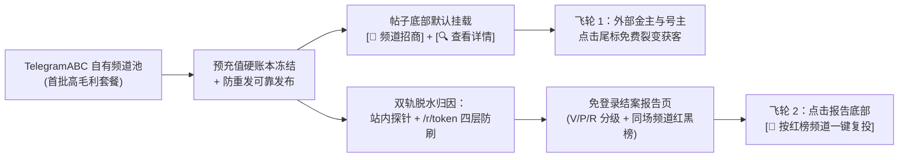

# 插播 Ad Lab V1｜深度研究与产品企划总报告（R2.1 深度调研完备版）

> **版本**：立项企划总报告 R2.1（已完成 10 大专项与 A～E 任务深度核查）  
> **更新日期**：2026-11-05  
> **配套五份深度分册报告（位于 `DOC/` 目录，点击可直接审阅）**：  
> - 📋 **[00_负责人决策摘要.md](DOC/00_负责人决策摘要.md)**（两页速读拍板指南）  
> - 🔍 **[01_竞品能力与差异化矩阵.md](DOC/01_竞品能力与差异化矩阵.md)**（Telega.io / AdsGram / TGStat / 官方 Ads / Collaborator 深度拆解）  
> - 🛡️ **[02_Telegram数据与归因可行性.md](DOC/02_Telegram数据与归因可行性.md)**（官方 API 边界、预加载防刷、站内探针真伪核查与 AI 条款红线）  
> - 💰 **[03_商业模式与利润模拟.md](DOC/03_商业模式与利润模拟.md)**（本地库资产实盘、五种变现模式对比、低中高三档损益与敏感性测算）  
> - 🧠 **[04_AI推荐与优化系统路线.md](DOC/04_AI推荐与优化系统路线.md)**（修正现有 100 分满分膨胀缺陷、三维可解释评分、贝叶斯平滑与组合分配）  
> - 🚀 **[05_MVP功能优先级与项目决策.md](DOC/05_MVP功能优先级与项目决策.md)**（`ChaBo` 189 项单测与源码级审计、`TelegramABC` 集成契约、16 项功能裁决与合规防控）

---

## 一、 核心结论与对 R1 / R2 初稿的关键纠偏（必读）

经过对官方 API 文档、竞品公开机制以及本地 `ChaBo` 代码库（实跑 189 个测试 + SQLite 数据表核查）的独立交叉审计，我们对 R1 和 R2 初稿中的偏差进行了以下 **5 项关键修正**：

1. **【纠偏 R1 工程路线】否定“新建 `chabo-next` 推倒重写”，确立“基于 `ChaBo` 原位外科手术升级”**
   - **实测证据**：当前 `ChaBo` 仓库已有 `189` 个自动化测试（核心硬账本、双人复核入账、三端网页、链式 SHA-256 防篡改审计全部跑通）。
   - R1 担心的“发帖超时重复发送”缺陷位于 `src/chabo/fulfillment.py` 第 `32～196` 行；但同仓库的 `SelfPromoService`（`src/chabo/services/channel.py` 第 `960` 行）**已经写好了标准的“事务内锁定状态 $\rightarrow$ 事务外调 Telegram 接口 $\rightarrow$ 事务内回写结果”范式**。只需半天（约 80 行代码）即可修复 `fulfillment.py`，推倒重写将白白浪费 1～2 个月工期。
2. **【纠偏 R2 技术断言】“站内探针 `/start`” $\neq$ “100% 人类生物真人”**
   - **实测与协议证据**：虽然 `t.me/bot?start=ad_x` 能 **100% 免疫 HTTP 链接预览爬虫（`TelegramBot`）** 并拿到真实 `telegram_user_id`，但灰黑产可用 MTProto Userbot 僵尸号矩阵脚本批量调用 `messages.startBot` 伪造 `/start`；同时正常人类点击深链后还需手动按一次底部 Start 按钮，存在 30%～60% 自然漏斗损耗。
   - **修正方案**：对外严禁宣传“100% 真人”，统称**「站内实名账号去重互动」**；对内必须叠加**“账号资料/Premium 特征 + 点击时间分布熵 + 详情页二跳率 + 跨频道黑名单”**四重反作弊过滤（详见《[02_Telegram数据与归因可行性.md](DOC/02_Telegram数据与归因可行性.md)》）。
3. **【纠偏跳转策略】当推广目标是 Telegram 内部频道/Bot 时，严禁套用 `/r/{token}` HTTP 短链！**
   - 若把 `t.me/xxx` 套进外部 HTTPS 302 短链，iOS/Android 客户端会先弹出外链安全警告、拉起浏览器再二次唤起 Telegram，流失率高达 30%～50%。
   - **修正铁律**：跳外部独立网站用 **`/r/{token}` 302 短链**；跳 Telegram 内部频道/群用 **官方专属邀请链接（`createChatInviteLink`）**；跳合作 Bot 用 **`?start=` 原生深链**。
4. **【纠偏现有代码商业逻辑】立即拆除“广告主 Pro 会员付费墙”与修复“评分 100 分膨胀”**
   - **代码与数据库实测证据**：
     1. 现有代码要求广告主先交钱买 Pro 套餐才能批量下单和看完整报表，在平台早期属于“把衣食父母往外推”的自杀设计——**V1 必须对充值广告主 100% 免费开放批量排期与完整结案报告**。
     2. 实查 `chabo.sqlite3` 发现，现有 `PricingService.assess_channel()` 算法导致 3 个演示频道全部算出 `100` 分满分，失去区分度；且当前库内 6 个频道和 6 笔待审订单（\$90）均为演示数据，需导入 `TelegramABC` 真实自有频道替换（详见《[03_商业模式与利润模拟.md](DOC/03_商业模式与利润模拟.md)》与《[04_AI推荐与优化系统路线.md](DOC/04_AI推荐与优化系统路线.md)》）。
5. **【纠偏冷启动对比口径】样本不足 30 单前，用“同场频道红黑榜横评”代替“全行业历史分位数”**
   - 冷启动期没有足够历史数据计算“打败了 80% 同行”，强行展示属于伪科学；应通过**「单次联投 5 个频道，在结案报告中直接对比这 5 个频道的实测 CPC 高低，标出红榜复投号与黑榜淘汰号」**，零历史数据也能帮客户做出高价值复投决策。

---

## 二、 商业闭环与财务可行性总览（详见分册 03）

### 1. 为什么必须以“自有频道套餐 + 代投服务”起盘？
* **纯撮合抽佣的死穴**：若无自有频道，纯靠第三方频道抽取 **8%** 担保佣金（扣除 1.5% 支付损耗后净留存 6.5%），要覆盖 \$2,120/月的单人全职运营与服务器成本，**每月必须撮合 \$32,615 GMV（约 163 单）才能保本**。
* **自有矩阵 + 代投的降维优势**：依托 `TelegramABC` 自有频道（近 100% 毛利）+ 15% 代投服务费，**每月仅需 3.5 单（约 \$700 GMV）即可盈亏平衡**！

### 2. 低、中、高三档月度财务模拟摘要（单位：USD，假设单次活动均价 AOV = \$200）

| 规模阶段 | 月订单数 | 月总流水 (GMV) | 自有频道消化占比 | 平台月度总毛利 | 固定人力与服务器成本 | **月度税前净利润** |
| :--- | :---: | :---: | :---: | :---: | :---: | :---: |
| **低规模（M1-M2 冷启动期）** | 15 单/月 | \$3,000 | 70%（\$2,100） | \$2,397 | -\$705（兼职运营+通道费） | **+\$1,692 / 月** |
| **中规模（M3-M5 成长期）** | 55 单/月 | \$11,000 | 40%（\$4,400） | \$5,903 | -\$2,285（1全职运营+通道费） | **+\$3,618 / 月** |
| **高规模（M6-M12 扩张期）** | 160 单/月 | \$32,000 | 25%（\$8,000） | \$13,120 | -\$5,730（3人团队+通道费） | **+\$7,390 / 月** |

---

## 三、 产品核心竞争力与增长飞轮（详见分册 01、02、04）

1. **双轨脱水归因**：
   - **站内探针（`[🔍 查看详情]`）**：0 弹窗警告、识别实名 TG 账号去重点击，叠加 4 维反 Userbot 校验；
   - **站外短链（`/r/{token}`）**：四层清洗管线（剥离 `TelegramBot` 预加载、机房突发连点、24h 短期指纹去重、异常激增告警），同时输出「原始请求数」与「脱水有效点击数」。
2. **三维可解释频道评分（AdLab Channel Score v2）**：
   - 废除一刀切满分，输出 **综合质量分 $S \in [0, 100]$**（30% 阅读健康度 + 35% 贝叶斯平滑点击力 + 20% 波动稳定性 + 15% 履约守信度）+ **样本置信度 $C$** + **刷量异常风险灯（绿/黄/红）**。

---

## 四、 技术演进与 MVP 实施路线（详见分册 05）

### 1. 架构原则：在当前 `ChaBo` 仓库上仅做 4 个增量切片
遵循《[CLAUDE.md](CLAUDE.md)》单向分层拓扑与只增不改契约，不建新仓库，不强上重型中间件，一期继续使用 SQLite（WAL 模式）：

* **切片 1（0.5 天）**：加固 `src/chabo/fulfillment.py`，仿照 `SelfPromoService` 将 Telegram 发帖请求移出数据库事务，增加 `send_unknown` 对账状态，彻底消灭超时重复发帖。
* **切片 2（1.5 天）**：解除广告主批量计划与报表的 Pro 付费墙限制；升级 `PricingService` 三维评分公式；编写 `TelegramABC` 频道导入脚本与首批联投套餐配置。
* **切片 3（2～3 天）**：在 FastAPI 新增 `GET /r/{token}` 302 短链跳转与四层防刷清洗表（`click_requests` / `click_events`），并接入 MTProto `channels.getMessages` 实现 1h/6h/24h 浏览量快照与删帖巡检。
* **切片 4（2～3 天）**：新增免登录只读结案报告页（`/public/reports/{share_token}`），展示 V/P/R 数据标签、同场频道红黑榜、下期预算腾挪建议与 `[一键复投]` 按钮。

### 2. 五道通关门（Gates）
* **G0（真机排雷）**：完成 iOS/Android 外链跳转弹窗实测与 `TelegramABC` MTProto 读 `views` 验证。
* **G1（资产就位）**：导入首批 5～10 个真实自有频道，`fulfillment.py` 故障注入测试零重复发帖。
* **G2（首单内测）**：在自有频道跑通“双人复核充值 $\rightarrow$ 批量排期 $\rightarrow$ 自动发帖置顶 $\rightarrow$ 24h 快照与点击清洗 $\rightarrow$ 自动扣费结算”。
* **G3（报告交付）**：生成首份带 V/P/R 标签与同场频道红黑榜的免登录结案报告。
* **G4（复投验证）**：首个真实付费广告主认可报告并完成复投，且 `[📣 频道招商]` 尾标带来自然询盘。
